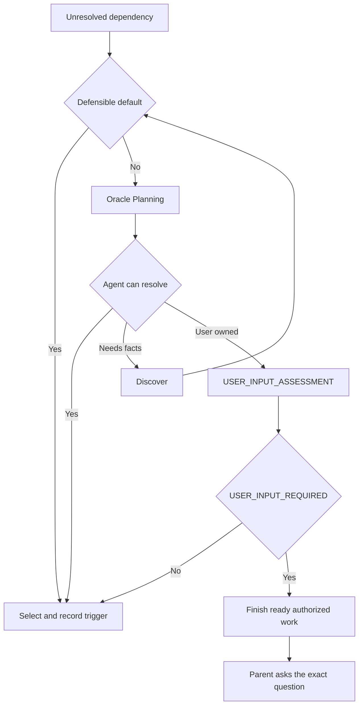
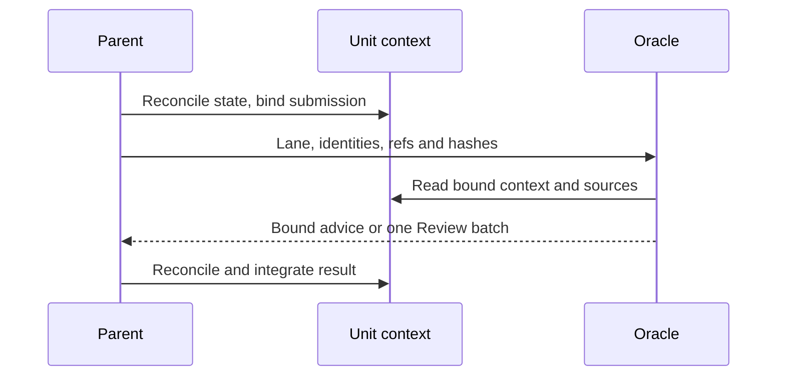

# Agent protocol entry point

Read this file, then only the reference for the lane you are in.

| File | Owns | Load when |
|---|---|---|
| `references/review.md` | Review modes and entry conditions, dispatch discipline, `REVIEW_ASSIGNMENT v1`, `oracle-review-result` schema, IDs, correction and anti-loop rules, effort limit | Any `DELIVERY`, `STATIC/DESIGN`, or `BLOCKED_REVIEW` dispatch |
| `templates/reviewed_unit.md` | Durable carrier of a Reviewed unit's context | First Reviewed dispatch and every resume |
| `xdev/SKILL.md` | xdev lifecycle, revisions, todos, closure | xdev route or closure assessment |

Write `<skill>/<path from its root>` (e.g. `agent-review/references/review.md`) in a skill, template,
record, or assignment, resolved through the installed skill roots; bare `references/…` and
`templates/…` mean this skill's directory, and repository files use `skills/<skill>/<path>`. Never
write `../` traversal: a record's directory is unrelated to a skill, so it breaks on instantiation.

Loading is mandatory: a missing or unreadable required file stops the work and is reported to the
parent as a missing dependency, never a license to proceed on assumptions or to ask the user.
Frontmatter or dispatch naming is discovery metadata only; it delivers no rules.

## Common assignment contract

Every assignment supplies lane and identity (lane, objective ID and goal revision, unit, decision,
dependency, or candidate identity, logical task ID and generation, route), original intent with exact
authorizations, bound context with hashes and base, evidence with sources, contrary evidence, gaps,
and access limits, current state, and the lane contract — never a requested answer, verdict, or
approval. Planning also gets options with exclusion reasons, costs, and reversibility, unresolved
assumptions, and a labeled parent leaning with the evidence that would change it: never pre-frame an
option as approved or seek ratification, and Oracle may reject an artificially narrow set. A bounded
Direct consultation needs no Reviewed context record.

## Lanes

Route and lane selection are separate: bounded advice never raises Direct to Reviewed, and a
`STATIC/DESIGN` PASS never lowers a Reviewed unit's delivery Review. Review lanes load
`references/review.md`; the xdev closure lane loads `xdev/SKILL.md`, sole authority for xdev
mechanics. `BLOCKED_REVIEW` is a Review mode, not a sixth lane, and returns only `Verdict: FAIL`.

| Lane | Parent supplies | Oracle returns | Never |
|---|---|---|---|
| **Planning** | Common contract, decision evidence | Target or selected authorized option; rationale; assumptions; acceptance, evidence, validation owner; reconsideration trigger; discovery actions; an `oracle-advisory-result` with its `ADVISORY` brief | Route change, authorization, delivery approval, repair gating |
| **Input assessment** (`USER_INPUT_ASSESSMENT`) | Dependency ID, purpose, missing item, discovery tried, grants, alternatives, why assumptions are inadequate | One `oracle-input-assessment` record | A question outside the JSON, a menu, authorization, closure |
| **`STATIC/DESIGN` Review** | Sources, criteria, own evidence, full assignment | One verdict plus `oracle-review-result` and its `orchestratorBrief` at stage `QUALITY` | Delivery Review, consuming the ordinary cap, repeated use on one unit |
| **`DELIVERY` Review** | Integrated unit, `REVIEW_READY`, full assignment | One verdict plus `oracle-review-result` and its `orchestratorBrief` at stage `DELIVERY`, whose post-FAIL actions are `remedy` only | Running missing validation, approving future corrections, piecemeal review |
| **xdev closure assessment** | Revision-bound candidate: ID, revision, outcome, task, generation, evidence | `CONTINUE_REQUIRED`, `USER_INPUT_REQUIRED`, or `TERMINAL_PREMISE_SUPPORTED`, advisory | Delivery verdict, state edit, contact permission |

### The advisory result (Planning — defined here, not only in `review.md`)

Planning's lane reference is not `references/review.md`, so its return contract must be complete in
this file. Beside its required decision explanation, Planning returns exactly one fenced
`oracle-advisory-result` block and no Review verdict:

```json
{"version": 1, "dependencyId": "<assigned stable decision/dependency ID>",
 "orchestratorBrief": {"stage": "ADVISORY",
   "judgment": {"qualityLevel": "NOT_ASSESSED", "authorDecisionItems": [
     {"id": "<decision ID>", "owner": "parent", "decision": "<the decision>",
      "selectedOption": "<selected option>", "rationale": "<basis>", "assumptions": [],
      "reconsiderationTrigger": "<evidence that would change it>", "evidenceRefs": []}]},
   "nextActions": [{"kind": "execute", "owner": "parent",
     "instruction": "<bounded next action>", "acceptancePredicate": "<observable condition>",
     "findingIds": [], "decisionIds": ["<decision ID>"]}]}}
```

- `stage` is always `ADVISORY`; `qualityLevel` is always `NOT_ASSESSED`, since Planning assesses no
  delivered quality.
- `nextActions[].kind` is one of `execute | discover | validate`, each with a proposed `owner`
  (`parent | fixer`, never delegation or authorization), and nonempty `instruction` and
  `acceptancePredicate`.
- `authorDecisionItems` carries the same fields as everywhere else — `id`, `owner`, `decision`,
  `selectedOption`, `rationale`, `assumptions`, `reconsiderationTrigger`, `evidenceRefs` — and is where
  a justified decision belongs, as distinct from a defect in submitted sources.
- References must be real: every `findingIds` and `decisionIds` entry must resolve to an actual
  finding or decision item, and **each action must reference at least one real finding or decision**;
  an anonymous action is contract-invalid.
- This block neither supplements nor relaxes the exact `oracle-input-assessment` or xdev closure
  contracts.

## Decisions and user contact



Agent-owned: technical, implementation, strategy, architecture, and ordinary product choices,
including defensible uncertainty and "is this in scope". Exactly three dependencies are user-owned:
**authorization** for a required protected effect; **access/fact** — indispensable access,
credentials, secrets, or facts only the user can supply, where no reasonable compliant assumption
can be recorded and continued on, making them irreplaceable; **product-intent** — genuinely
incompatible readings of the request that change the expected outcome, where an implementation
tradeoff satisfying the stated outcome is not ambiguity.

Choosing among valid options is an Oracle decision, never a user decision, and a menu is a ladder
violation: select one within authorization, record the rationale and reconsideration trigger, and
treat obtainable gaps as discovery, not contact. Oracle may select an authorized alternative
satisfying the objective, but cannot grant authorization or remove protection. Emit exactly one
structured `oracle-input-assessment` record for a labeled `USER_INPUT_ASSESSMENT`:

```json
{
  "version": 1,
  "dependencyId": "<id from the assignment>",
  "outcome": "AGENT_DECISION | USER_INPUT_REQUIRED",
  "selectedOption": "<AGENT_DECISION only>",
  "rationale": "<AGENT_DECISION only>",
  "assumptions": ["<AGENT_DECISION only>"],
  "reconsiderationTrigger": "<AGENT_DECISION only>",
  "kind": "authorization | access | fact | product-intent",
  "dependency": "<USER_INPUT_REQUIRED only: the exact missing item>",
  "question": "<USER_INPUT_REQUIRED only: the exact question the parent should ask>",
  "whyAgentCannotResolve": "<USER_INPUT_REQUIRED only>"
}
```

Carry the question only in the JSON `question` field; never print a `USER_QUESTION:` line, which the
parent owns. A completed call is not permission to ask, and the record grants no authorization,
continuation decision, verdict, or closure.

## Context handoff



The parent binds each dispatch to the context record's exact path and byte hash, the unit and goal
identity, the task generation, and the product snapshot; `references/review.md` owns snapshot and
evidence rules. "Oracle never loses context" means the context is reconstructible or its inadequacy
detected: on resume read the recorded locator, check pending generations, reload the contracts, and
reconcile every non-superseded result; conflicting material context fails closed.
