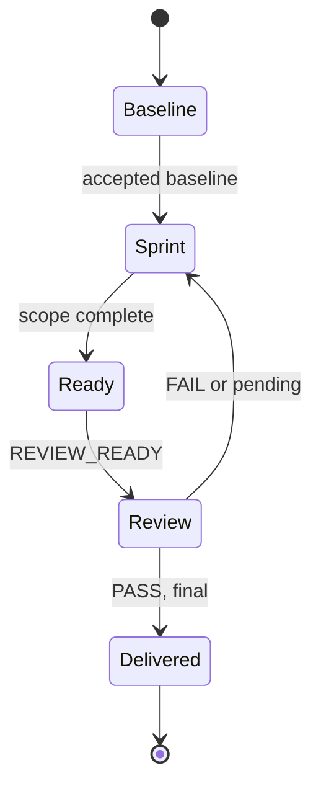
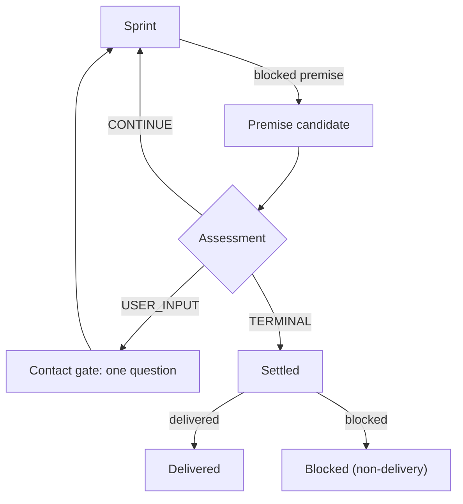

# xdev

xdev is the durable lifecycle for complex multi-sprint work requiring coordination
across phases, risk boundaries, or context limits: coherent target baseline →
risk-bounded sprints → final whole-state verification. `plan_and_track.md` is its
sole durable state record. The baseline defines intended behavior, authoritative
basis, acceptance evidence, and risk boundaries.

Before acting, load `agent-review/SKILL.md`. The orchestrator prompt owns protected effects, the
decision ownership test, target and quality, snapshots and durable evidence, media, and the source
corpus, and the parent contract owns routing, safety, liveness and recovery, user contact,
reconciliation, escalation, and completion policy. Both are siblings of this directory, so one
relative path serves repository and installed skill roots. This skill owns only the durable
lifecycle; if a bound reference is unavailable, do not act on obligations that require it.

## Bootstrap, resume, and state authority

- Resolve one deterministic locator per objective: use the caller's exact path,
  or `.tmp/xdev/{objective-slug}/plan_and_track.md`. Normalize only the slug:
  lowercase, trim, replace each run of non-alphanumeric characters with a hyphen,
  then trim hyphens. Record the exact resolved path and objective identity.
- Bootstrap creates only an absent file; never overwrite an existing plan.
  A default-path collision with another objective requires stopping or escalation
  under global policy. Resume reuses the locator and reads the record before
  dispatch; missing, conflicting, or ambiguous locators require escalation.
- Templates carry `schema_version`. Bootstrap, migration, and malformed-state
  recovery read the exact templates and fail closed unless versions and required
  fields can be migrated safely. Ordinary resume reads the recorded schema,
  locator, task/todo/evidence fields, and status, without rereading template prose.
  Before creating or updating a sprint block, read the exact
  `xdev/templates/sprint_block.md` and preserve its required fields.
  If a template is unavailable, search existing plans for matching objective
  identity before creating anything; ambiguity fails closed. Never silently
  create a second plan.
- The Orchestrator alone writes the record and its authoritative checkbox list:
  one writer per state record/worktree. Planning, Fixer, and Review return
  contracts, reports, verdicts, evidence, or proposed changes—not state edits.
  Transport status, results, notifications, and availability inform reconciliation
  but cannot reconstruct semantic state. Repair only from the record and
  authoritative task reports/evidence under global reconciliation policy.
- Todo IDs are stable and never reused. Unchecked means outstanding; check only
  after recording reconciliation, integration, required evidence, state revision,
  and an authoritative reference. Never silently delete or reopen a todo;
  replacements and follow-ups receive new IDs with lineage. Todos reference the
  task ledger for transport/generation/integration, sprint contracts for acceptance,
  and evidence/Review for results rather than duplicating those authorities.
- Reconcile the complete todo list on resume, before dispatch, after results, before
  Review readiness, and before a closure candidate. Readiness requires scoped implementation,
  correction, integration, and required-validation todos discharged; one designated Review-action
  todo per delivery unit stays open until `PASS`. Record failed attempts and replacements by task
  generation; create correction todos for actual blocking work, not another Review attempt.
  Preserve completed evidence as historical rather than rewriting it as current.

## Durable revisions, snapshots, and recovery

Every durable semantic write increments **State revision** exactly once.
An atomic transition applies all related semantic changes and bindings together
from R to N=R+1; never half-apply task/todo/candidate creation or its references.
Create logical tasks, candidates, and todos at revision N before dispatch.
Dispatch, runtime-ID recording, and running/pending transport updates are
revision-neutral unless they change scope, acceptance, integration, or closure
premise. Formatting-only edits are neutral unless authoritative content changes.
Closure binds logical task ID plus generation and revision—not runtime identity;
atomic closure integration follows **Parent-objective closure**.

Each validation and Review record includes its state revision and unit/state
snapshot ID. Bind product inputs by exact paths and content hashes or a commit/tree
identifying those bytes, including material modes, under the shared snapshot rules.
Historical sprints retain their original snapshot IDs; final whole-state validation
and Review share one final snapshot ID recorded in current state and final records.

Transport-only references cannot discharge todos or establish readiness. Record, ledger, todos,
validation and Review records, and references must suffice for resume after context reset: preserve
terminal result and evidence references and replacement reasons, not volatile unchanged-resume
counts or nudge history.

## Durable task ledger and outcomes

Create one ledger entry per authorized dispatch in its pre-dispatch transition.
Record logical task ID, generation, role/lane, exact scope, runtime transport ID,
Status, supersedes/replacement lineage, integration state, authoritative terminal
result/evidence reference, and replacement reason where applicable.
Logical task ID plus generation are identity; runtime ID is transport metadata.
A replacement creates a new generation for unfinished scope. Planning and Review
are immutable, distinct lanes, each with at most one active generation; apply
global background-task transport/replacement rules.

One unit record holds current scope, readiness, and validation authority; resume
fields reference it rather than restating values. Missing runtime-ID receipts
during dispatch do not invalidate logical-task/generation binding. Historical
entries describe their recorded state, not current authority.

The lifecycle has one **Outcome**: `active`, `delivered`, or `conclusively blocked`.
Sprint/task **Status** is separate: `pending`, `running`, `completed`, `failed`,
`blocked`, `cancelled`, or `superseded`. Local result classifications never imply
or replace Outcome. `delivered` requires satisfied contract and validation;
`conclusively blocked` requires an exact recorded blocker and no viable in-scope
remediation, means terminal non-delivery, and satisfies no delivery criterion.

Keep Status current before dispatch and after integrated results. Resume uses explicit revision,
phase, current sprint, next owner and action, pending tasks, integration, validation, final Review,
and outcome fields — not a vague `Latest`. History retains only recovery-significant baseline and
Review acceptance, completed or reviewed sprints, revisions, material blockers and replacements,
final validation, and completion; routine dispatches, diagnostics, and failures update Status or
their sprint or task entry.

## Active-lifecycle continuation

Before ending an xdev root turn, reread the exact resolved plan and reconcile received results against
its complete authoritative todo list. Execute or dispatch the next authorized action unless:
- The lifecycle is terminal under **Completion and Review** and **Parent-objective closure**.
- The separate user-input gate permits the necessary question, the question is asked, and no other authorized action remains ready.
- No action is ready and a named, non-superseded task is confirmed live, with its task ID and generation recorded.

A user-owned dependency blocks only dependent work; finish other feasible authorized actions and
prepare blocked effects as allowed. Status updates, child completion, remediable failure, context
pressure, compaction, and a future Next action are not terminal exits. An automatic `CONTINUE`
handoff may carry durably recorded ready work into the next root turn; it never permits terminal
closure or abandonment of an active objective. A live-task wait must retain its automatic-resume
path.

## Baseline, sprint, and Review evidence

For every baseline, sprint, or final-validation check or scenario, record state revision, snapshot ID under the rules above, execution owner, expected and actual results, status (`PASS`, `FAIL`, or `BLOCKED`), command exit status when applicable, and material raw-output or evidence references: a summary cannot replace evidence needed for inspection or reproduction.

Review records additionally identify the Review revision and owner and contain the
independent verdict and findings. Every Review dispatch fills the Review Assignment from
`agent-review/references/review.md` and returns its `oracle-review-result`; that reference,
not this one, owns entry conditions, assignment fields, the result schema, finding IDs, the
effort cap, second-FAIL stabilization, and anti-loop rules. Precondition failure is
`Verdict: FAIL` with `REVIEW_PRECONDITION_NOT_MET`; `BLOCKED_REVIEW` is never approval.

## Completion and Review

Successful completion requires Outcome `delivered`, final-validation results for every approved check, all required validation complete, final whole-state Review `Verdict: PASS` with required evidence, zero pending tasks, and integration of every non-superseded result. Reconcile the complete todo list under the ledger rules above; delivered closure requires every non-closure todo satisfied.

Each risk-boundary sprint receives independent delivery Review only after the `REVIEW_READY` gate and xdev todo reconciliation: scoped implementation, correction, integration, and validation todos discharged, the designated Review-action todo open until its result is integrated.

Batch sprints before Review. A sprint's completion is not by itself a reason to Review: consolidate consecutive sprints into one delivery Review whenever they share a contract, invariants, or validation, and hold a Review-receivable unit until its accepted scope and all identified corrections are complete. Split only for failure isolation, ordering, or materially different invariants — never merely at a sprint boundary. A batched Review's assignment names every covered sprint. A last or only sprint Review also serves as the final whole-state Review when scope and evidence coincide; otherwise obtain one whole-state Review.

Terminal transitions follow **Parent-objective closure**; `conclusively blocked` is terminal non-delivery, never successful completion.

## Parent-objective closure

A closure candidate proposes a terminal Outcome for the parent objective after the Orchestrator rereads the exact resolved plan and reconciles baseline and criteria, all sprints, task generations and supersession, integration, validation, Review findings, blockers, recovery attempts, remaining authorized actions, and the complete todo list.

| Trigger or binding | Required record or transition |
| --- | --- |
| Routine recovery with Outcome `active` | Orchestrator-owned; no closure assessment required. |
| Delivered closure fully covered by final sprint Review | If its scope and evidence exactly equal the whole-state scope and every completion invariant holds, the `PASS` plus Orchestrator reconciliation may transition to `delivered` without a separate assessment. |
| Blocked/negative closure or any uncovered delivered-closure premise | Requires a separate revision-bound Oracle closure assessment. |
| Candidate binding before dispatch | At revision N record candidate ID and revision N, proposed Outcome, reconciliation, authoritative evidence references, and the Oracle logical task ID and generation. Oracle reads the entire plan and authoritative references directly and assesses that candidate at N. |
| Assessment binding | Durably bind the assessment to candidate ID, candidate revision, proposed Outcome, Oracle logical task ID, task generation, and authoritative assessment reference. Its conclusion is advisory; the Orchestrator alone writes state and owns the decision. |
| `TERMINAL_PREMISE_SUPPORTED` | Permits the Orchestrator's terminal decision only with matching binding and all applicable completion or blocked-settlement invariants. |
| `CONTINUE_REQUIRED` | Outcome remains `active`; continue authorized work. |
| `USER_INPUT_REQUIRED` | Outcome remains `active`; identifies the user-owned dependency and proposed question but does not permit contact. Apply the separate gate below. |
| Missing, malformed, stale, unavailable, contradictory, or unreconciled evidence | Fail closed: Outcome stays `active`; no terminal transition or user-facing claim. |
| Atomic integration | Record the bound task's terminal result, assessment, decision, and designated closure-assessment todo settlement as one transition from N to N+1; neither that result nor the integration invalidates the binding. Only a substantive event changing the closure premise requires a new candidate and assessment. |

`awaiting_user` is an execution disposition, not an Outcome. Before contact following
`USER_INPUT_REQUIRED`, satisfy the global `USER_INPUT_ASSESSMENT` evidence gate. One Oracle Planning
task may supply both records only if explicitly assigned `USER_INPUT_ASSESSMENT` with a dependency
ID; otherwise obtain that assessment separately.

Todo settlement differs by terminal Outcome:
- **Delivered:** every non-closure todo is satisfied and every completion invariant, including final
  whole-state Review `PASS`, holds.
- **Conclusively blocked:** record an evidence-backed blocker and establish that no viable authorized
  action remains; satisfied todos stay satisfied, and each unfinished todo receives an explicit
  evidence-backed unmet or blocked disposition explaining its dependency and why no actionable work
  remains. Never mark unfinished work satisfied or discharged merely to close the lifecycle.
- **Assessment pending:** for Delivered candidates the designated assessment todo alone may remain
  open at candidate revision N; for conclusively blocked candidates evidence-backed unmet or blocked
  todos may also remain open without being treated as satisfied or discharged. Settle the designated
  assessment todo atomically at N+1 as specified above.

Missing, contradictory, stale, or unreconciled todo state prevents Review readiness or terminal
closure, and no terminal user-facing claim is permitted while Outcome remains `active`.

## Lifecycle

The main line is deliberately short; the premise branch forks off it, and the next drawing
carries that branch to its three outcomes. Between them an objective can only end at
`Delivered`, or at a settled non-delivery.

`Settled` records exactly one proposed Outcome — `proposed Outcome = delivered` or
`proposed Outcome = conclusively blocked` — and the assessment that supports it.

1. **Baseline.** Author and accept it under the shared target/corpus rules. Invoke Planning only
   when its triggers apply; there is no preimplementation Baseline Review. Record the
   final-validation execution owner, and carry the objective-level goal statement, goal status,
   and initial-clarification-used/reference state so a resumed or compacted root reuses it
   instead of re-asking.
2. **Sprints.** Execute approved bounded sprint contracts. Use review-worthy risk boundaries, not
   arbitrary files or checklist items: combine mechanical changes sharing a contract and
   validation; split for failure isolation, ordering, or materially different invariants. Prefer
   fewer, larger sprints; do not split merely to produce more review boundaries.
3. **Evidence.** Reconcile under **Baseline, sprint, and Review evidence**, then apply
   **Completion and Review**.
4. **Final verification.** The designated owner runs the approved final checks; the Orchestrator
   integrates their evidence and obtains final whole-state Review per **Completion and Review**.
5. **Settlement.** Reconcile completion and settle the objective under **Parent-objective
   closure**.

